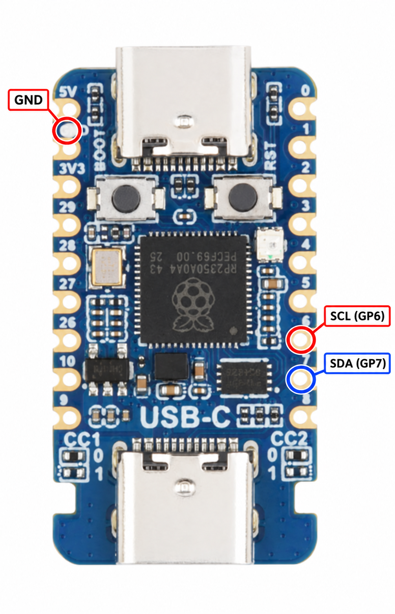

# EC Programmer

A Windows GUI and Raspberry Pi Pico firmware for ITE EC debug access over a
two-wire bus. The application identifies an EC, reads a 256 KiB window, and
enables erase/write only when its flash protocol profile is identified.

## Current support

The manufacturer selector contains **ITE** and the family selector contains
**IT51xx**, **IT55xx**, and **IT8xxx**. IT51xx and IT55xx are discovery entries;
their read/write protocols have not been implemented. IT8xxx supports DBGR
identification and a 256 KiB page read. Family selection alone does not prove
that a particular EC accepts this protocol or has that capacity.

Write and Erase require the currently implemented **ITE eFlash 8315, 256 KiB**
profile. It is recognized from CHIPID, CHIPVER, and the flash ID. This profile
has completed a physical erase, full image write, and byte-for-byte verify on
one EC. That is not validation of every IT8xxx part. The application refuses
destructive operations when the profile cannot be identified. A completely
blank chip can still match the profile because identification does not depend
on differing flash contents.

## Download and run

The local `release/` directory is a release staging area and is excluded from
Git. Its `app/` folder contains the Windows EXE; `pico-firmwares/` contains
board-specific UF2 files. Download the GitHub Release, flash the UF2 matching
your board through BOOTSEL, connect its USB data port to Windows, and run the
EXE. The firmware uses USB CDC; Windows 10/11 normally supplies the serial
driver. Zadig/libusbK is not used by this build.

Board-specific UF2 files are compiled from the same source. The release has
builds for Raspberry Pi Pico, Pico W, Pico 2, Pico 2 W; Waveshare RP2040-Zero,
RP2350-Zero, RP2350-USB-A; and Seeed XIAO RP2040 and RP2350. Header-equipped
Pico variants use the UF2 of their corresponding base model. A compiled UF2
does not prove that a board or EC has been physically tested. Use the board's
USB **device** port; on the Waveshare RP2350-USB-A board this is USB-C, not
its USB-A host connector. See the [board firmware map](docs/BOARD_FIRMWARES.md)
for exact filenames and wiring notes.

## Wiring and use

### Waveshare RP2350-USB-A wiring



With the board oriented as shown, connect **GND** to the EC board ground,
**GP6** to EC SCL, and **GP7** to EC SDA. The photo marks GPIO numbers; the
target board's EC pins must be identified separately.

See [Wiring and operation](docs/HARDWARE.md). The Pico needs EC SDA, EC SCL,
and a shared ground. Identify the target board's actual EC programming pins
from its schematic or measured netlist. The GUI defaults to GP7 for SDA and
GP6 for SCL, but both are selectable. The EC side must use 3.3 V logic and
have pull-ups; Pico pins are open drain during the entry waveform.

Select the COM port, manufacturer, family, SDA and SCL pins, then click
**Connect to EC**. A usable connection enables Read. A recognized write
profile also enables Write and Erase. **Read** opens a save dialog when the
read finishes. **Write** asks for an image, erases the EC, programs it, and
verifies every byte. **Erase** only erases. There is no automatic backup before
Write; use Read first if you want one. If the EC cannot enter debug mode while
powered, the app arms the Pico and asks you to cycle the target's power.

## Build from source

Python 3.10+ on Windows:

```powershell
py -3 -m venv .venv
.\.venv\Scripts\python.exe -m pip install -r app\requirements.txt
.\.venv\Scripts\python.exe -m app
```

Build a Windows EXE with:

```powershell
.\.venv\Scripts\pyinstaller.exe --noconfirm EC-Programmer.spec
```

For UF2 builds, install the Raspberry Pi Pico SDK (including submodules),
CMake, Ninja, and the Arm GNU toolchain. Run, for example:

```powershell
cmake -S firmware -B firmware/build-pico -G Ninja -DPICO_SDK_PATH=C:/path/to/pico-sdk -DPICO_BOARD=pico
cmake --build firmware/build-pico
```

Replace `pico` with any board name in the
[firmware map](docs/BOARD_FIRMWARES.md); use a separate build directory for
each board.
The output is `pico_ec_probe.uf2`. See [release preparation](docs/RELEASING.md)
for the complete board list and staging checklist.

## License and credits

Project code is MIT licensed. DBGR and SPI follow-mode sequences draw on
Chromium OS EC `iteflash`; the entry waveform is informed by
`I2C-Pico-USB-ITE-EC-prog`. See [source attribution](docs/THIRD_PARTY.md).
No laptop BIOS, EC image, vendor application, or customer dump is distributed.
